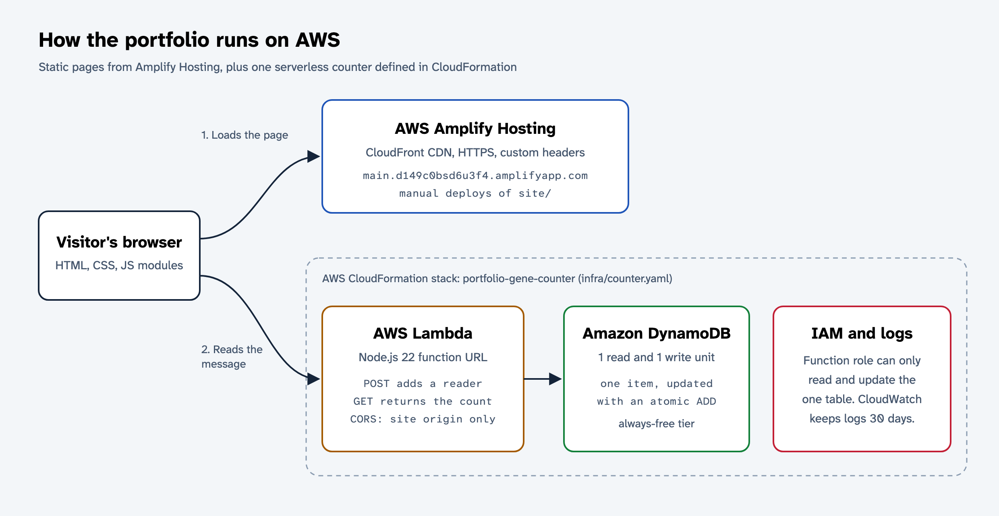

# Noel Sason's portfolio

A one-page portfolio with a hidden gene in it, hosted on AWS Amplify Hosting.

- Live site: https://main.d149c0bsd6u3f4.amplifyapp.com
- Built for the AWS Student Builder Challenge, October to November 2026.

The page has About me, Skills, Projects, Experience, and Contact sections, plus a light and dark theme toggle. Its creative feature, **Translate the gene**, starts from the DNA sequencing trace in the hero. Visitors translate the gene with an *E. coli* ribosome, which stops at `MEETN` because UAG is a stop codon. Then they switch to *Methanosarcina barkeri*, which reads UAG as pyrrolysine (`O`), and the protein spells `MEETNOELSASON`. Visitors can also mutate any base, ask an assistant about what their change did, write their own name in protein, and see how many people have read the message.

## Run it locally

The site is plain HTML, CSS, and JavaScript modules with no build step and no dependencies.

```sh
npm start   # serves site/ at http://localhost:4173
npm test    # runs the genetics unit tests with node:test
```

## Project layout

| Path | What it holds |
|---|---|
| `site/index.html` | The page and the translator dialog |
| `site/css/styles.css` | Design tokens, layout, and light and dark themes |
| `site/js/genetics.js` | Codon table, translation, mutation classes, and name encoding. No DOM code, so Node tests it. |
| `site/js/translator.js` | The translator dialog: ribosome animation, base editing, and the name tool |
| `site/js/main.js` | Draws the sequencing trace, opens the dialog (also from `#gene` links), and runs the theme toggle |
| `site/js/theme.js` | Applies a saved theme before first paint. A classic script, because the CSP blocks inline scripts. |
| `site/js/counter.js` | Calls the reader counter. Any failure hides the count line. |
| `site/js/assistant.js` | The "Ask about this gene" panel: prepared answers, plus questions sent to the ask function |
| `infra/ask.yaml` | CloudFormation template for the assistant's Lambda function |
| `infra/ask/` | The assistant's function code (`index.mjs`) and its one dependency, `@anthropic-ai/sdk` |
| `tests/genetics.test.mjs` | Unit tests for the genetics logic |
| `infra/counter.yaml` | CloudFormation template for the reader counter |
| `customHttp.yml` | Response headers, including the Content Security Policy |
| `amplify.yml` | Build settings if the Amplify app is ever connected to this repo |
| `scripts/deploy.sh` | Manual deploy to Amplify Hosting |

## AWS architecture



| Service | Role |
|---|---|
| AWS Amplify Hosting | Serves `site/` over HTTPS through Amplify's CloudFront distribution. App `d149c0bsd6u3f4`, branch `main`, manual deployments. |
| AWS Lambda | `POST` adds one reader and `GET` returns the count. Node.js 22, exposed through a function URL with CORS limited to the site's origin. |
| Amazon DynamoDB | One table with one item, provisioned at 1 read and 1 write unit (inside the always-free 25 and 25). The function uses an atomic `ADD`, so concurrent readers can't overwrite each other. |
| AWS CloudFormation | Stack `portfolio-gene-counter` in `us-east-1` creates the table, role, function, function URL, permissions, and log group from `infra/counter.yaml`. |
| AWS IAM | The function's role can only call `GetItem` and `UpdateItem` on that one table. |
| Lambda: ask | Answers a visitor's question with Claude Opus 5.5 at low effort. It takes only the question, the DNA, and the organism, and rebuilds the protein and edit list itself, so visitor text never reaches the model as page state. Checks a 10-a-day global limit and a 3-a-day per-visitor limit (hashed IP) with conditional DynamoDB updates before calling the model, and returns the use if the call fails. |
| Systems Manager Parameter Store | `/portfolio/anthropic-api-key`, a SecureString. The ask function reads it once per cold start. |
| Amazon S3 | `portfolio-artifacts-429334543090-us-east-1`, private, holds the ask function's zip. Builds expire after 30 days. |
| Amazon CloudWatch Logs | Keeps the function's logs for 30 days. The function logs errors only (`ApplicationLogLevel: ERROR`, `SystemLogLevel: WARN`). |

The counter is public on purpose and has no authentication, so anyone can inflate it with repeated `POST` requests. Each browser counts itself once, using `localStorage`. The count is a fun number, not a metric.

### Cost

The account is on the AWS Free plan (credits, no charges unless the plan is upgraded, expires 2027-04-30). The counter stays inside the always-free limits: DynamoDB's provisioned 1/1 units throttle spam to about one write per second, and Lambda's 1M free requests a month cover normal traffic. Amplify Hosting traffic draws on the plan's credits. Don't upgrade the account plan unless the site needs to outlive the Free plan.

### Response headers

`customHttp.yml` holds the headers: HSTS, `nosniff`, a referrer policy, and a Content Security Policy. The policy allows scripts only from the site and network calls only to the site and the two Lambda function URLs. It also sets `frame-ancestors 'none'`. The live headers come from the Amplify app's settings, which hold the same YAML. To change the headers, edit the file, then apply it to the app:

```sh
aws amplify update-app --app-id d149c0bsd6u3f4 --region us-east-1 \
  --custom-headers "$(cat customHttp.yml)"
```

## Deploy

To deploy the site, sign in with the AWS CLI (`aws login`) and run the deploy script. It runs the tests, zips `site/`, uploads the zip to Amplify, and waits for the job to finish.

```sh
scripts/deploy.sh
```

To update the counter stack after you edit `infra/counter.yaml`, run:

```sh
aws cloudformation deploy --region us-east-1 \
  --stack-name portfolio-gene-counter \
  --template-file infra/counter.yaml \
  --capabilities CAPABILITY_IAM \
  --parameter-overrides AllowedOrigin=https://main.d149c0bsd6u3f4.amplifyapp.com
```

The stack outputs `CounterUrl`, the value of `COUNTER_URL` in `site/js/counter.js`.

To update the assistant, install its dependency, zip it, upload the zip under a new key, and deploy the stack with that key:

```sh
cd infra/ask && npm install --omit=dev && zip -qr ../../ask.zip index.mjs package.json node_modules && cd ../..
KEY="ask/ask-$(shasum -a 256 ask.zip | cut -c1-12).zip"
aws s3 cp ask.zip "s3://portfolio-artifacts-429334543090-us-east-1/$KEY"
aws cloudformation deploy --region us-east-1 \
  --stack-name portfolio-gene-ask \
  --template-file infra/ask.yaml \
  --capabilities CAPABILITY_IAM \
  --parameter-overrides CodeBucket=portfolio-artifacts-429334543090-us-east-1 CodeKey="$KEY" \
    AllowedOrigin=https://main.d149c0bsd6u3f4.amplifyapp.com \
    CounterTableName=portfolio-gene-counter-CounterTable-1OXHQI4YTTFCO
```

The stack outputs `AskUrl`, the value of `ASK_URL` in `site/js/assistant.js`. Both function URLs must also be listed in the CSP's `connect-src`. The API key is stored once, outside the templates:

```sh
aws ssm put-parameter --region us-east-1 --name /portfolio/anthropic-api-key \
  --type SecureString --value "$ANTHROPIC_API_KEY"
```

## The biology

- The gene is 14 codons long: `ATG GAG GAA ACC AAC TAG GAG CTG TCC GCC AGC TAG AAT TAA`.
- The standard genetic code (NCBI table 1) treats UAG as a stop codon. *Methanosarcina* species read UAG as pyrrolysine, the 22nd amino acid, with one-letter code `O`.
- In the name tool, `U` is selenocysteine. Human cells read UGA as selenocysteine only when the RNA carries a SECIS element, and the human genome has 25 selenoprotein genes. `B`, `J`, `X`, and `Z` are ambiguity codes, not amino acids.
