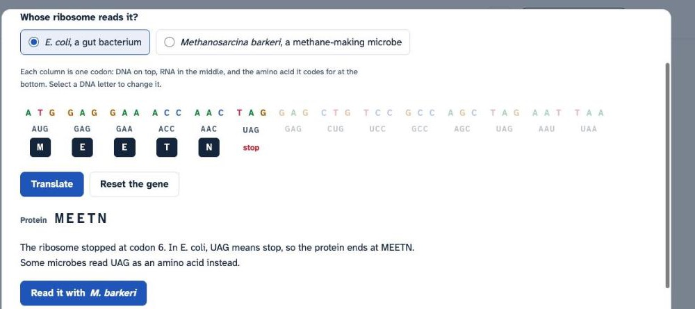
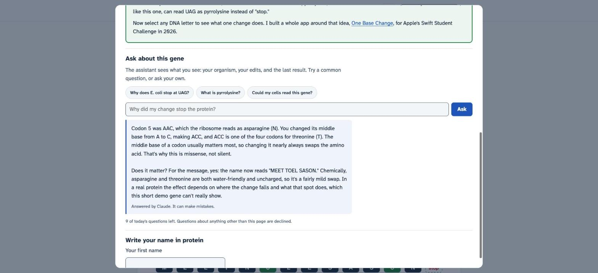
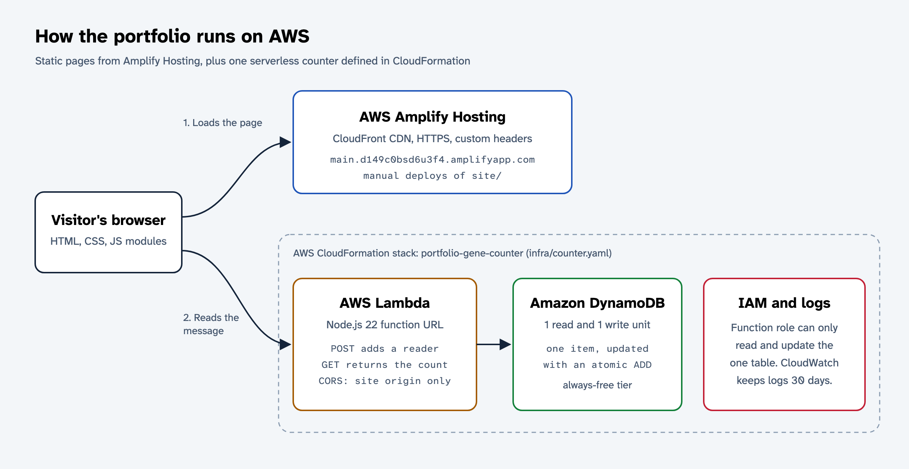
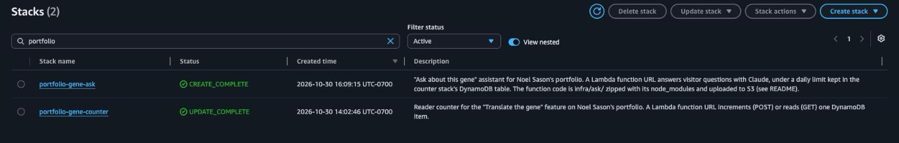
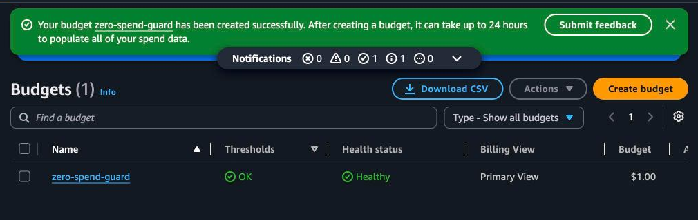

# Translate the gene: Noel Sason's portfolio

Live site: https://main.d149c0bsd6u3f4.amplifyapp.com

Code: https://github.com/NoelSason/portfolio

## Try it in 30 seconds

1. Open the site and press Translate the gene, under the sequencing trace or in the top bar.
2. Watch E. coli read the gene. It stops after five amino acids, at MEETN.
3. Press Read it with M. barkeri. The same gene now spells MEET NOEL SASON.
4. Select any DNA letter to mutate it, then ask the assistant what your change did.
5. Type your own first name at the bottom of the dialog to see whether any cell could make it.

## What I built

My portfolio is a one-page site with About me, Skills, Projects, Experience, and Contact sections, hosted on AWS Amplify Hosting. I'm a junior at UC Berkeley double majoring in Molecular & Cell Biology and Data Science, so I wanted the creative feature to come from molecular biology, which is the half of my background most portfolios don't have.

Every skill links to the projects that used it, and every project has a status: shipped or used live, research, prototype, or submitted. I wanted a reader to tell at a glance which things are live and which are hackathon prototypes.

## The creative feature: Translate the gene

The first thing under my name is a DNA sequencing trace, the chart a Sanger sequencing run produces, with one colored peak per base. It shows a 42-base gene I wrote. Under the trace is one empty slot per codon, and the caption says the protein spells a message that E. coli can't finish reading.

The Translate the gene button opens the translator, and E. coli starts reading right away. A ribosome slides along the RNA one codon at a time, with the RNA running between its two subunits as it does in a cell. Each amino acid has a one-letter code, so the protein spells words. E. coli stops at the sixth codon, UAG, which is a stop codon in almost every organism, so the protein ends at MEETN.

Then one button switches to Methanosarcina barkeri, a methane-making microbe. It reads UAG as pyrrolysine, the 22nd amino acid, whose one-letter code is O. The full protein is MEETNOELSASON, and the reveal builds it from amino-acid tiles. The point is that a human cell can't write my name, because human cells don't make pyrrolysine. After someone reads it, the empty slots on the home page fill in with the message.

There are two more things to try. You can select any DNA letter to mutate it. The page says whether the change was silent, missense, or nonsense, and the reveal tiles update, so one base change can turn my name into MEET TOEL SASON. This is a small version of One Base Change, the DNA mutation app I made for Apple's Swift Student Challenge in 2026.

You can also type your first name and get it back as codons, with a verdict on whether any cell could make that protein. Names with an O need pyrrolysine. Names with a U need selenocysteine, which human cells do make, in 25 proteins. B, J, X, and Z aren't amino acids at all. A share button copies a link that opens the translator with your name already written in protein.

The dialog also has an assistant you can ask about what's on screen. It sees what you see: the organism, your edits, and the last result. So after a mutation you can ask "why did my change turn the N into a T?" and get an answer about codon 5 specifically. Three common questions have prepared answers that show up instantly. Anything else goes to Claude through AWS Lambda, limited to 10 questions a day across all visitors and 3 per visitor, and the page labels which answers came from the model. It declines questions that aren't about the page, and anything that could help someone cause harm with biology.

The translator lives in a dialog, so the rest of the site stays a normal page with normal navigation. It works with a keyboard, with one tab stop for the whole sequence and arrow keys between bases, and it skips the animation for visitors who turn on reduced motion. On phones the trace splits into two rows, and the Translate and Reset buttons stay pinned to the bottom of the dialog. The site also has a dark theme that follows the system setting until the visitor picks one.

## AWS services I used

- AWS Amplify Hosting serves the site from the main branch through Amplify's CloudFront distribution. I set custom response headers on the app, including a Content Security Policy that allows scripts only from the site itself and network calls only to my two Lambda function URLs.
- AWS Lambda runs the reader counter, a small Node.js 22 function behind a function URL. A POST adds one reader and a GET returns the count. CORS on both function URLs allows only my Amplify domain.
- Amazon DynamoDB stores the count as one item. The function updates it with an atomic ADD, so two visitors at the same moment can't overwrite each other. The same table holds the assistant's daily limits, and a time-to-live setting deletes those records after two days.
- A second Lambda function runs the assistant. It checks both daily limits with conditional DynamoDB updates before it calls the model, and gives the question back if the call fails. It uses the official Anthropic SDK, so its code is zipped with its dependencies and loaded from a private S3 bucket that deletes old builds after 30 days.
- AWS Systems Manager Parameter Store holds the Anthropic API key as an encrypted SecureString. The function reads it once per cold start, so the key isn't in the code, the repo, the environment variables, or the browser.
- AWS CloudFormation creates both backends from two templates in my repo. infra/counter.yaml has the table, the counter function, its URL and permissions, and a log group. infra/ask.yaml has the assistant's function, URL, role, and log group.
- AWS IAM gives each function its own role. The counter can only read and update its table. The assistant can only update that table and read that one parameter.
- Amazon CloudWatch Logs keeps each function's logs for 30 days. The functions only log errors, so normal visits don't write anything.
- The AWS CLI, signed in with aws login, and the AWS MCP server connected my coding agent to my AWS account.

I deploy with a script, scripts/deploy.sh. It runs the tests, zips the site folder, and sends it through Amplify's deployment API. The site is plain HTML, CSS, and JavaScript with no build step, so a build server would only copy files, and this way no third-party service needs access to my AWS account.

## Keeping it free

My AWS account is on the Free plan, which runs on credits and never charges my card unless I upgrade the plan. I also kept the backend inside the always-free limits so normal traffic doesn't use the credits.

The table started as on-demand, which bills every request. I switched it to provisioned at 1 read and 1 write unit, which is inside DynamoDB's always-free tier. Both function URLs are public, and anyone can inflate the counter, so I made spam fail quietly. After a short burst, DynamoDB throttles writes to about one per second, and the page hides the count line instead of showing an error. I also added a zero-spend budget and turned on Free Tier alerts, so I get an email if anything starts to cost money. The assistant's model calls are billed by Anthropic, not AWS, and the daily limit keeps that to a few cents a day.

## How I built it

I used Claude Code as my coding agent. It wrote most of the code while I decided what the page says, what the feature does, and whether the result was right. All the genetics logic (the codon table, translation, mutation types, and name encoding) is in one file with no browser code in it, so its unit tests run in Node. They check that the codon table has 61 codons for 20 amino acids plus 3 stop codons, that E. coli stops at MEETN, that M. barkeri reads the whole message, and that every letter in the name tool translates back to itself.

Before submitting, I had separate review agents judge the site against the rubric, critique the design, and test it for bugs, and I fixed what they found. My caption called the gene "real," which overstated it. The reveal didn't update after a mutation. The trace and its hint sat below the fold on a laptop screen. A mutation after the stop codon was labeled as a nonsense mutation even though the ribosome never reads it, accented names like José lost letters, and on a phone the back button left the site instead of closing the dialog. The genetics file now has 10 tests, including ones for those cases.

## Challenges

- A public Lambda function URL needs two resource-based permissions, lambda:InvokeFunctionUrl and lambda:InvokeFunction, and the second one should be limited to calls that come through the URL. I found that in the CloudFormation reference before deploying, so the stack came up on the first try.
- Visitor text had to stay data, not instructions. The browser sends only the question, the DNA, and the organism. The function rebuilds the protein and the list of edits itself instead of trusting what the page says, strips angle brackets so a question can't close its own tag, and the system prompt tells the model to ignore instructions inside the question.
- The daily limit had to hold even if many people asked at once. Each question first adds one to a per-visitor counter and a daily counter with a conditional DynamoDB update, which fails once the limit is reached, so two requests can't both take the last question. If the model never answers, the question is given back. If it answered but the answer was unusable, the question still counts, because it was billed.
- The assistant needed my Anthropic API key, and I didn't want it anywhere a visitor or the repo could see it. It went straight from my local config into Parameter Store as a SecureString, the function's role can read only that one parameter, and the browser only ever talks to the function URL.
- Testing the assistant without spending its daily budget took some care. My automated browser tests map the function URLs to localhost, so they exercise the interface and the error states without calling the model, and I asked only a couple of real questions by hand and then cleared those uses.
- The biology had to be right, because the whole joke depends on it. E. coli treats UAG as a stop codon, Methanosarcina reads it as pyrrolysine, and selenocysteine needs an extra signal in the RNA. I wrote tests for the genetic code so a typo in a 64-entry table can't quietly break the message.

## What I learned

The thing that surprised me most was how much the billing mode matters on a tiny project. On-demand DynamoDB would have drawn on my credits for every visit, and provisioned capacity at 1 and 1 costs nothing and also limits spam for free. I also learned that a public endpoint can't be made spam-proof without paying for something, so the honest design is one that fails quietly. For the assistant that meant checking the limits before calling the model, not after, so the worst case is a polite "come back tomorrow" instead of a bill. If I did this again, I would deploy from GitHub Actions with a short-lived role instead of running a script by hand, so every push updates the site.
