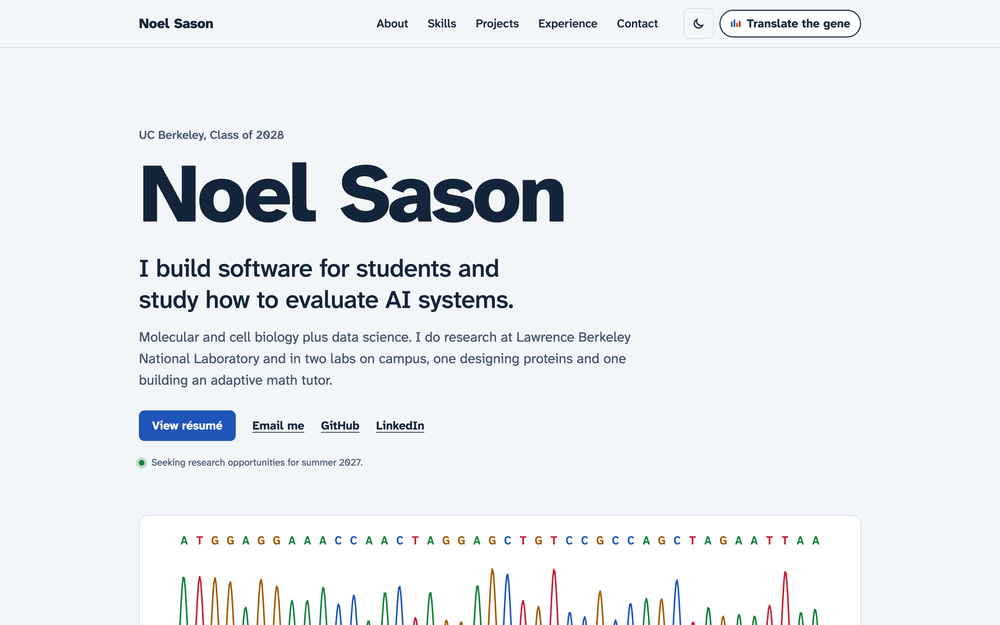
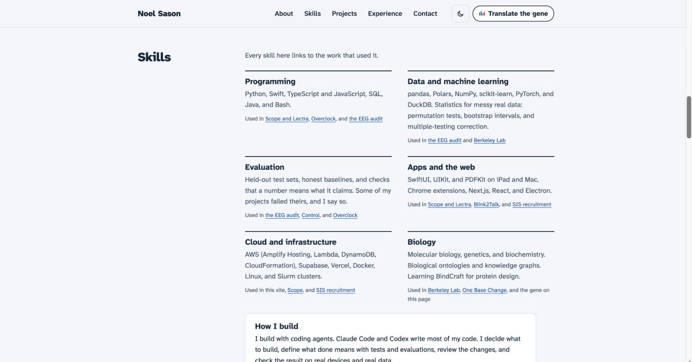
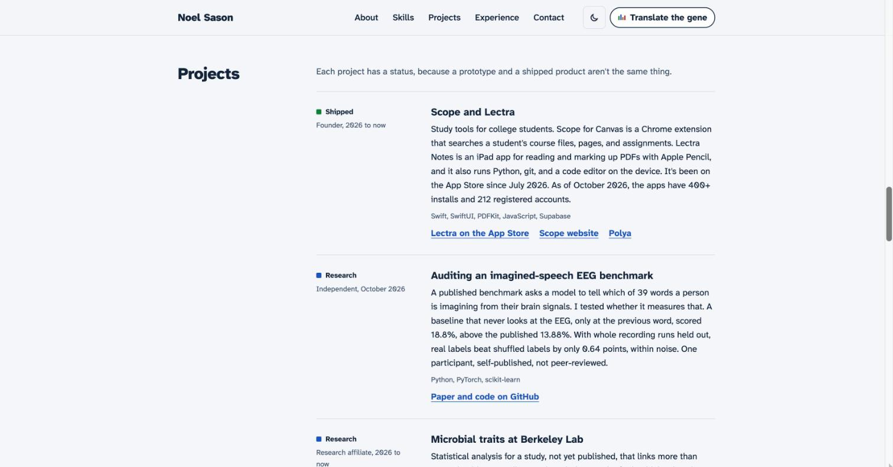
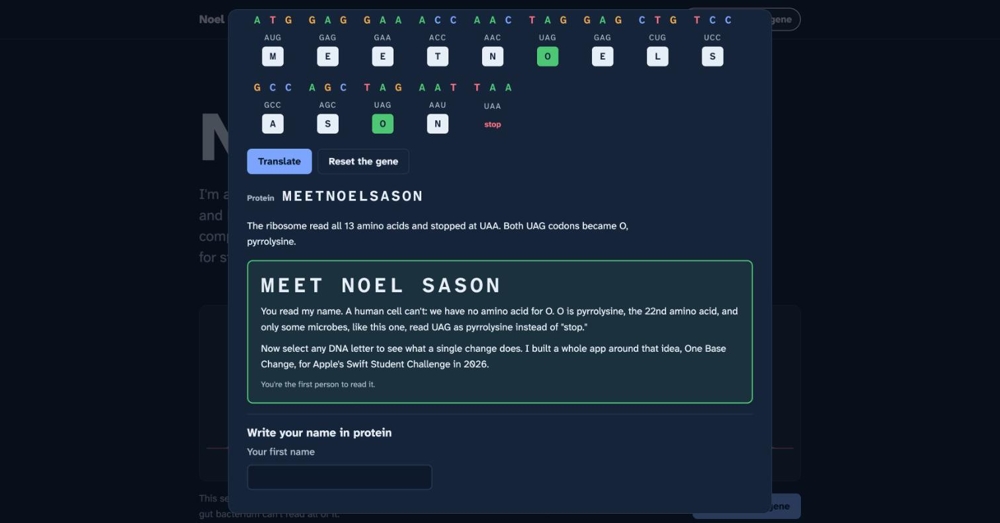
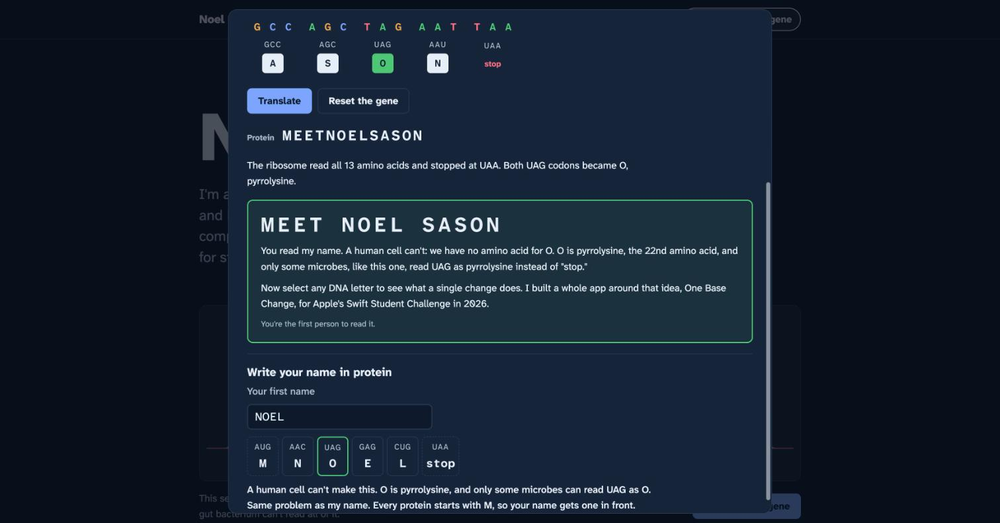
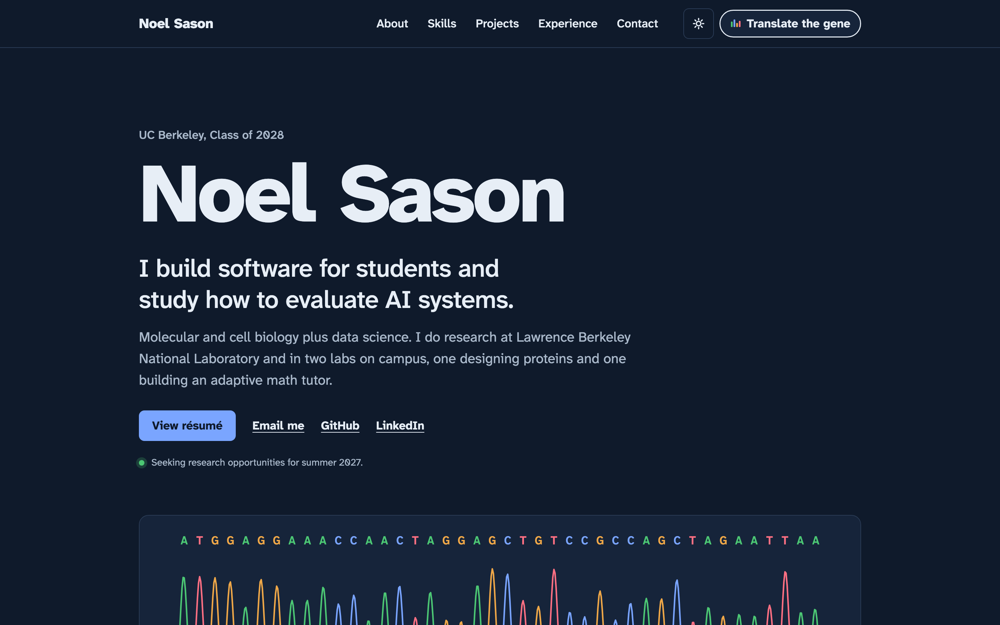
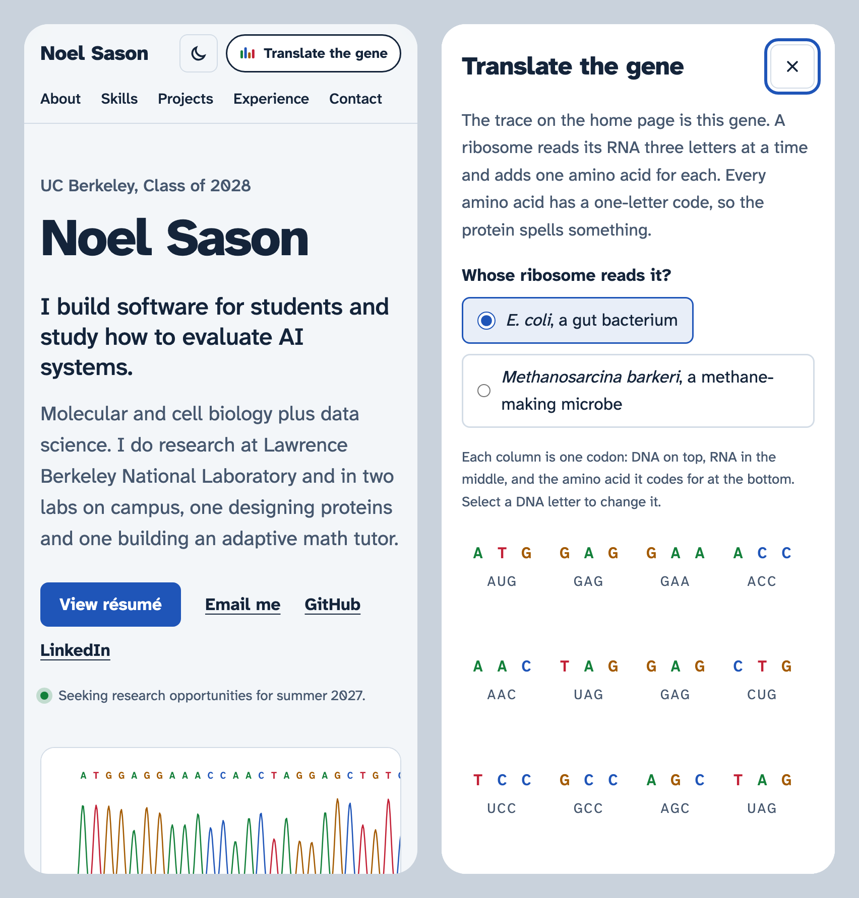
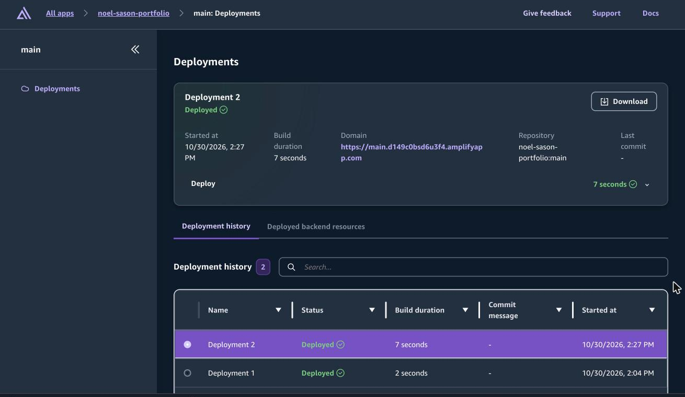
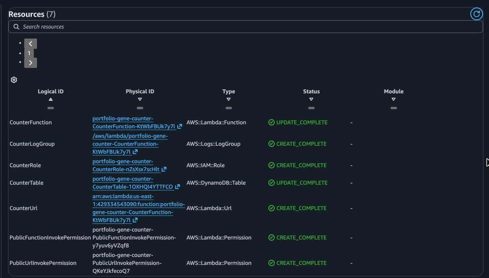
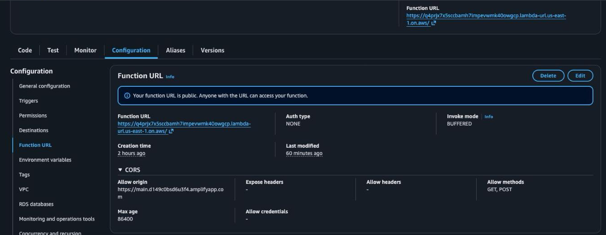

<!--
Before you paste this into "Your project" on Builder Center:
1. Push this folder to https://github.com/NoelSason/portfolio (public). The footer's source link and the repo link in this write-up point there.
2. Run the Claude in Chrome prompt from the session. It sets up the zero-spend budget and Free Tier alerts that "Keeping it free" describes, and saves the three AWS console screenshots to docs/screenshots/aws/ (amplify-console.png, cloudformation-stack.png, lambda-function-url.png).
3. Read "What I learned" and rewrite anything that isn't true for you. I drafted it from what happened during the build.
Everything after this comment is the paste-ready write-up.
-->

# Translate the gene: Noel Sason's portfolio

Live site: https://main.d149c0bsd6u3f4.amplifyapp.com

Code: https://github.com/NoelSason/portfolio

## What I built

My portfolio is a one-page site with About me, Skills, Projects, Experience, and Contact sections, and it runs on AWS Amplify Hosting. I'm a junior at UC Berkeley double majoring in Data Science and Molecular & Cell Biology, so I wanted the creative feature to come from the half of my background that most portfolios don't have, which is molecular biology. Every project on the page has a status label (shipped, research, prototype, or submitted), because I wanted a reader to know which things are live and which ones are hackathon prototypes, and every skill links to the projects that used it, so nothing on the skills list is a claim without evidence.

## The creative feature: Translate the gene

The first thing under my name is a DNA sequencing trace, the chart you get back from a Sanger sequencing run, with one colored peak for each base. The caption says the trace is a real gene whose protein spells out a message and that a gut bacterium can't read all of it. I put a Translate the gene button under the trace and another one in the navigation bar, so the way in is visible from every part of the page.

The button opens the translator, where you pick whose ribosome reads the gene and press Translate. The ribosome moves along the RNA one codon at a time and the amino acid chain builds underneath it, and since every amino acid has a one-letter code, the protein spells words. If you pick E. coli, translation stops after five amino acids at MEETN, because the sixth codon is UAG and UAG is a stop codon in almost every organism. The status line then says that some microbes read UAG differently, and if you switch to Methanosarcina barkeri, a methane-making microbe, the ribosome reads UAG as pyrrolysine, the 22nd amino acid, whose one-letter code is O, and the full protein comes out as MEETNOELSASON. The point of the reveal is that a human cell can't write my name, because human cells don't make pyrrolysine.

After the reveal there are two more things to try. You can select any DNA letter to mutate it, and the page tells you whether the change was silent, missense, or nonsense and translates the protein again, which is a small version of One Base Change, the DNA mutation app I made for Apple's Swift Student Challenge in 2026. You can also type your own name and get it back as codons with a verdict on whether any cell could make that protein. Names with an O need pyrrolysine, names with a U need selenocysteine (which human cells do make, in 25 proteins), and B, J, X, and Z aren't amino acids at all. The reveal also shows a live count of how many people have read the message, and that count is the part that runs on AWS beyond the hosting.

I kept the translator in a dialog, so the rest of the site stays a normal page with normal navigation. I made it work with a keyboard, with one tab stop for the whole sequence and arrow keys to move between bases, and it skips the animation for visitors who turn on reduced motion. I also gave the whole site a dark theme, which follows the visitor's system setting until they pick one with the toggle in the header.

## AWS services I used

- I host the site on AWS Amplify Hosting from the main branch as a manual deployment, and Amplify serves it through its CloudFront distribution. I set custom response headers on the app, including a Content Security Policy that only allows scripts from the site itself and only lets the page call my Lambda function URL.
- AWS Lambda runs the reader counter, a small Node.js 22 function behind a function URL. A POST adds one reader and a GET returns the count, and CORS on the URL only allows my Amplify domain.
- I store the count in Amazon DynamoDB as one item in a table provisioned at 1 read and 1 write unit, which is inside DynamoDB's always-free tier, and the function updates it with an atomic ADD so two visitors at the same moment can't overwrite each other.
- I create the whole counter with AWS CloudFormation from one template in my repo, infra/counter.yaml, which has the table, the IAM role, the function, the function URL and its permissions, and a log group.
- AWS IAM gives the function a role that can only read and update that one table.
- Amazon CloudWatch Logs keeps the function's logs for 30 days, and the function only logs errors, so normal visits don't write anything.
- The AWS CLI, signed in with aws login, and the AWS MCP server connected my coding agent to my AWS account.

## Keeping it free

My AWS account is on the Free plan, which uses credits and never charges my card unless I upgrade the plan, and I made the backend fit inside the always-free limits so normal traffic doesn't use up the credits either. The counter is the only public endpoint, so if someone spams it, DynamoDB throttles the writes to about one per second and the page hides the count instead of showing an error. I also added a zero-spend budget and turned on Free Tier alerts, so I get an email if anything ever starts to cost money.

## How I built it

I used Claude Code as my coding agent, and it wrote most of the code while I decided what the page says, what the feature does, and whether the result was right. The site is plain HTML, CSS, and JavaScript with no framework and no build step. All the genetics logic (the codon table, translation, mutation types, and name encoding) is in one file with no browser code in it, so it has 8 unit tests that run in Node. The tests check that the codon table has 61 codons for 20 amino acids plus 3 stop codons, that E. coli stops at MEETN, that M. barkeri reads the whole message, and that every letter in the name tool translates back to itself. Before deploying I checked the page at desktop and phone widths in light and dark mode, and after deploying I checked the live response headers and ran the translator end to end against the real counter.

## Challenges

- A public Lambda function URL needs two resource-based permissions, lambda:InvokeFunctionUrl and lambda:InvokeFunction, and the second one should be limited to calls that come through the URL. I found that in the CloudFormation reference before deploying, so the stack came up on the first try.
- My Content Security Policy includes frame-ancestors 'none', which stops other sites from putting my page in a frame, and it also blocked my own screenshot setup, which loaded the live site in phone-sized frames. I took the phone screenshots from a local copy instead of weakening the header.
- Headless Chrome won't make a window narrower than about 500 pixels, so my first phone screenshot was really a cropped desktop layout and made the site look broken when it wasn't. I switched to loading the page in a 390 pixel frame.
- The sequencing trace is 42 bases wide, which doesn't fit on a phone at a readable size, so on phones the trace scrolls sideways inside its own box and the page itself never scrolls sideways.
- The biology had to be right, because the whole joke depends on it. E. coli treats UAG as a stop codon, Methanosarcina reads it as pyrrolysine, and selenocysteine needs an extra signal in the RNA, and I wrote tests for the genetic code so a typo in a 64-entry table can't quietly break the message.

## What I learned

I learned how much Amplify Hosting handles for a static site before I write any backend code, since HTTPS, the CDN, and the response headers all came from one app setting. I only needed Lambda and DynamoDB for the one feature that has to remember something across visitors, and because that part is written in CloudFormation, I can rebuild it from one file without remembering which console buttons I clicked. Setting the security headers taught me what each one actually blocks, including the one that blocked my own screenshots. Overall, the part I'm happiest with is that the creative feature uses both of my majors and still stays out of the way of the rest of the page.
